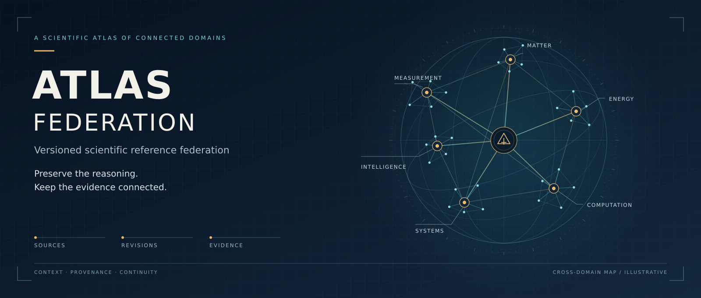

<p align="center">
  
</p>

<h1 align="center">ATLAS Federation</h1>

<p align="center">
  <strong>Centralized intelligence, locally.</strong><br />
  A shared knowledge base for AI tools to search first, then build.
</p>

<p align="center">
  <a href="#agent-quickstart">Agent quickstart</a> ·
  <a href="#start-here">Start here</a> ·
  <a href="#domain-directory">Domain directory</a> ·
  <a href="#research-amortization">Research amortization</a> ·
  <a href="#for-people-and-ai-systems">People &amp; AI</a> ·
  <a href="#evidence-and-integrity">Evidence</a> ·
  <a href="#restoration-and-preservation">Restoration</a> ·
  <a href="#rights-and-reuse">Rights &amp; reuse</a>
</p>

---

## Search locally. Build from existing knowledge.

**ATLAS Federation is a shared local knowledge base for AI tools to search before they build.** It brings scientific and engineering knowledge, source-linked claims, models, examples, and evidence into one versioned collection. The aim is to save repeated searches: reuse research already present, inspect its limits, and spend new research effort on what is missing or has changed.

Give your coding assistant, research agent, or retrieval tool a local checkout. It can find relevant domains, follow the sources and exact revisions, and use those foundations when designing or building. People can inspect the same evidence. You supply the checkout to your existing tools; cloning the repository simply makes the files available locally.

The long-term mission is technological continuity: keep useful knowledge and its reasoning available for learning, repair, reproduction, and future work. That mission depends on preserving context—assumptions, units, uncertainty, provenance, and the difference between a constructed model and a physical result.

> Search what is already known. Keep the evidence attached. Build from there.

Created by **James Paul Jackson**. ATLAS Federation continues the original **ATLAS FORGE** program; historical names, scientific records, and release filenames retain their original identities. The [founding charter](Standards/Human_Knowledge_Survival_Charter_v1.md) and [common research contract](Standards/Atlas_Common_Contract_v0.6.0.md) describe the mission and structure.

**Public status:** this repository is the public source mirror of **Compiler Design v0.2.0**, with 24 domain entry points and a [cleared source export in the original archive layout](PUBLIC_SOURCE_DIRECTORY.md). The public derivative has [explicit omissions and documented redactions](canonical/PUBLIC_OMISSION_MANIFEST.json). Its release asset is staged locally; upload and public download verification remain pending. The complete original archive remains private and unchanged. See [publication status](PUBLICATION_STATUS.md) before using this as a recovery copy.

## Agent quickstart

Start with Git and a local text-search tool such as `rg` (ripgrep):

```sh
git clone https://github.com/jacksonjp0311-gif/ATLAS-FEDERATION.git
cd ATLAS-FEDERATION
git rev-parse HEAD
rg --files canonical/COMPILER-DESIGN-ATLAS
rg -n -i --glob '*.md' 'control.flow|register allocation' canonical/COMPILER-DESIGN-ATLAS/docs
```

The first search lists the domain's local files; the second finds relevant explanations. Use the [24-domain directory](#domain-directory) or [original source layout](PUBLIC_SOURCE_DIRECTORY.md) to choose another domain. An existing retrieval tool can index the checked-out text and record collections; preserve paths, record identities, and revisions in that index.

For each build task:

1. **Search the local corpus first.** Locate the relevant domain, method, worked example, and known limitations.
2. **Pin the evidence.** Record the Git commit, source path, and record ID/revision where available. Follow linked source and review records before using a claim.
3. **Build within the stated scope.** Inspect relevant code, [tests](canonical/COMPILER-DESIGN-ATLAS/tests/), and [evidence](canonical/COMPILER-DESIGN-ATLAS/evidence/). Run applicable checks only after reviewing their dependencies and the public omission inventory.
4. **Research the gaps.** Search externally when evidence is missing or a fact needs a current check. Keep new findings and their dates separate from the preserved records.

Coverage is partial. The public derivative contains documented redactions and omissions, and some original commands require absent inputs. Local availability does not establish offline completeness, automatic tool integration, or successful scientific validation. The [publication notice](canonical/PUBLIC_BROWSABLE_NOTICE.md) and [verification receipt](evidence/publication/PUBLIC_DERIVATIVE_VERIFICATION.json) define the available artifact.

## Start here

| Your goal | Entry point |
| :--- | :--- |
| Put the local corpus to work in an AI build workflow | [Agent quickstart](#agent-quickstart) |
| Understand the mission and inspect the evidence as a person | [Human field guide](Continuity_Toolkit/ATLAS_HUMAN_FIELD_GUIDE.md) |
| Explore a scientific or engineering domain | [Domain directory](#domain-directory) |
| Browse the original source layout, shared records, and history | [Public source directory](PUBLIC_SOURCE_DIRECTORY.md) · [Canonical layout](canonical/) |
| Understand why research is packaged for reuse | [Research amortization](#research-amortization) · [Signal Atlas](https://github.com/jacksonjp0311-gif/SIGNAL-ATLAS) |
| Inspect the current scientific checkpoint | [Checkpoint record](CURRENT_CHECKPOINT.json) · [Edition overview](Atlas_Library_Index_Compiler_Design_v0.2.0.md) |
| Read the active domain in depth | [Compiler Design manual](Compiler_Design/DEPTH_MANUAL_v0.2.0.md) · [Edition notes](Compiler_Design/README_v0.2.0.md) |
| Integrate with a local model or research agent | [Common contract](Standards/Atlas_Common_Contract_v0.6.0.md) · [Use with AI systems](#for-people-and-ai-systems) |
| Verify the public derivative and inspect the original preservation record | [Restoration instructions](RESTORATION.md) · [Historical verification receipts](evidence/Compiler_Design_v0.2.0_incremental/) |
| Contribute a correction or extend the work | [Contribution and release protocol](Continuity_Toolkit/CONTRIBUTOR_AND_RELEASE_PROTOCOL.md) |

## Domain directory

The links below lead to **24 domain folders in this public source mirror**. They are grouped for navigation; the original research roadmap retains its own ordering. A folder can contain preserved historical editions or a frozen reference subset. Its presence alone does not establish completeness or scientific acceptance.

### Foundations, reasoning, and intelligent systems

| Domain | Browse source | Read first |
| :--- | :--- | :--- |
| Measurement | [Measurement](Measurement/) | [Release scope](Measurement/V1_Release_Scope_rc1.md) |
| Mathematics and fundamental physics | [Mathematics &amp; Physics](Mathematics_Physics/) | [Edition directory](Mathematics_Physics/README.md) |
| Signal | [Signal](Signal/) | [Preserved reference guide](Signal/README.md) |
| Cymatics | [Cymatics](Cymatics/) | [Preserved reference guide](Cymatics/README.md) |
| Causal reasoning | [Causal](Causal/) | [Reference guide](Causal/Causal_Reference_Guide_v1.0.0.md) |
| Control | [Control](Control/) | [Research editions](Control/) |
| Agents | [Agent](Agent/) | [Reference guide](Agent/Agent_Reference_Guide_v1.0.0.md) |
| Computation | [Computation](Computation/) | [Reference guide](Computation/Computation_Reference_Guide_v1.0.0.md) |
| Language | [Language](Language/) | [Reference guide](Language/Language_Reference_Guide_v1.0.0.md) |
| Neural architectures | [Neural Architectures](Neural_Architectures/) | [Scoped v1.0.0 notes](Neural_Architectures/README_v1.0.0.md) |

### Matter, energy, and fabrication

| Domain | Browse source | Read first |
| :--- | :--- | :--- |
| Materials | [Materials](Materials/) | [Coverage matrix](Materials/Materials_Coverage_Matrix_v1.0.0.md) |
| Chemistry | [Chemistry](Chemistry/) | [Reference guide](Chemistry/Chemistry_Reference_Guide_v1.0.0.md) |
| Energy | [Energy](Energy/) | [Reference guide](Energy/Energy_Atlas_Reference_v1.0.0.md) |
| Bioelectricity | [Bioelectric](Bioelectric/) | [v0.1.0 notes](Bioelectric/README_v0.1.0.md) |
| Manufacturing | [Manufacturing](Manufacturing/) | [v0.2.0 notes](Manufacturing/README_v0.2.0.md) |
| Electronics and semiconductors | [Electronics &amp; Semiconductors](Electronics_Semiconductors/) | [v1.0.0-rc.1 scope](Electronics_Semiconductors/README_v1.0.0-rc.1.md) |

### Software and computing infrastructure

| Domain | Browse source | Read first |
| :--- | :--- | :--- |
| Computer architecture and digital hardware | [Computer Architecture](Computer_Architecture/) | [Edition directory](Computer_Architecture/README.md) |
| Software design patterns | [Software Design Patterns](Software_Design_Patterns/) | [v0.1.0 notes](Software_Design_Patterns/README_v0.1.0.md) |
| Distributed systems | [Distributed Systems](Distributed_Systems/) | [Scoped v1.0.0 notes](Distributed_Systems/README_v1.0.0.md) |
| Cryptographic protocols | [Cryptographic Protocols](Cryptographic_Protocols/) | [Scoped v1.0.0 notes](Cryptographic_Protocols/README_v1.0.0.md) |
| Operating system internals | [OS Internals](OS_Internals/) | [Scoped v1.0.0 notes](OS_Internals/README_v1.0.0.md) |
| Network stacks | [Network Stacks](Network_Stacks/) | [Scoped v1.0.0 notes](Network_Stacks/README_v1.0.0.md) |
| Database optimization | [Database Optimization](Database_Optimization/) | [Scoped v1.0.0 notes](Database_Optimization/README_v1.0.0.md) |
| Compiler design · **active** | [Compiler Design](Compiler_Design/) | [v0.2.0 notes](Compiler_Design/README_v0.2.0.md) |

These folders provide browsable material corresponding to the **24-node canonical checkpoint**. Computer Architecture and Mathematics / Physics include versioned source roots and historical snapshots. Signal and Cymatics preserve the federation's frozen reference subsets; they are not complete standalone upstream applications. The [four-domain publication manifest](evidence/publication/four-domains-2026-11-20-manifest.json) records exact original paths, hashes, and excluded files. The [publication checks](evidence/publication/four-domains-2026-11-20-checks.json) document the selected test results and remaining historical-test limitations.

The separate [Signal Atlas research project](https://github.com/jacksonjp0311-gif/SIGNAL-ATLAS) develops research amortization. Its current repository and this federation's historical [Signal reference subset](Signal/) have distinct provenance. The full original federation archive remains unpublished. The [public source directory](PUBLIC_SOURCE_DIRECTORY.md) also maps the cleared derivative under `canonical/`, with its [omission inventory](canonical/PUBLIC_OMISSION_MANIFEST.json), [browsable file manifest](canonical/BROWSABLE_FILE_MANIFEST.json), and [verification receipt](evidence/publication/PUBLIC_DERIVATIVE_VERIFICATION.json). Its binary release asset remains staged locally. See [publication status](PUBLICATION_STATUS.md).

### Federation resources

| Location | Purpose |
| :--- | :--- |
| [Original source layout](PUBLIC_SOURCE_DIRECTORY.md) | Cleared domain source, shared records, preserved history, and explicit omissions under `canonical/` |
| [Standards](Standards/) | Shared record contract, build principles, provenance, and mission charters |
| [Roadmaps](Roadmaps/) | Original 30-domain plan, preserved priority decisions, and current active pointer |
| [Continuity Toolkit](Continuity_Toolkit/) | Human guides, offline tooling, preservation procedures, and evidence boundaries |
| [Federation indexes](federation/) | Historical cross-domain indexes and checkpoint records |
| [Release records](Releases/) | Versioned manifests and deterministic restoration material |
| [Evidence](evidence/) | Preserved test, oracle, history-preservation, and replay receipts |
| [Initial science export](science/Compiler_Design/) | The earlier browsable Compiler Design export, retained alongside the domain folders |

Historical indexes describe their own editions. For the latest canonical counts and active work, use [`CURRENT_CHECKPOINT.json`](CURRENT_CHECKPOINT.json) and the [current priority pointer](Roadmaps/ATLAS_FORGE_CURRENT_ACTIVE_PRIORITY.json).

## Research amortization

**Reuse research so each build does not start with the same searches.** Research amortization means spreading the cost of discovery, validation, and synthesis across later tasks and model calls. The local corpus gives an AI tool a place to retrieve existing work, check its evidence and applicability, and identify the specific gaps that still need research.

A working example is **[Signal Atlas](https://github.com/jacksonjp0311-gif/SIGNAL-ATLAS)**. Read its [Research Amortization implementation note](https://github.com/jacksonjp0311-gif/SIGNAL-ATLAS/blob/main/docs/research/RESEARCH_AMORTIZATION.md) for the definition, packet model, and evaluation plan.

<p align="center"><strong>Discover → Verify → Connect → Teach → Reuse → Measure</strong></p>

In ATLAS, the intended reusable unit carries the claim or method together with its source references, exact revision, assumptions, applicability, uncertainty, and relevant dependencies. That context gives the next investigator a way to assess whether earlier work still applies.

| Research effort | What should survive for the next use |
| :--- | :--- |
| Discover and inspect sources | Source identity, edition, locators, rights, and remaining evidence gaps |
| Develop an explanation or model | Assumptions, equations, worked examples, scope, and limitations |
| Test a result | Reproducible method, finite test scope, counterexamples, and receipts |
| Apply the material to a new question | Exact record revisions, dependencies, and a fresh applicability check |
| Learn that something changed | A traceable correction and a new revision, with prior evidence preserved |

For example, a later engineering task can start from an existing measurement method and its uncertainty model, then examine the new operating conditions and missing evidence. The value comes from retaining the earlier reasoning while making the new work explicit.

**The benefit must be measured.** Signal Atlas demonstrates deterministic retrieval of curated metadata and provenance-preserving packets. End-to-end savings in model compute, latency, or total research cost remain an evaluation question. Its [published evaluation boundary](https://github.com/jacksonjp0311-gif/SIGNAL-ATLAS/blob/main/docs/research/RESEARCH_AMORTIZATION_v05.md) distinguishes implemented retrieval from unproven performance claims. Any fair comparison must include preparation, maintenance, cache misses, freshness checks, and answer quality.

## For people and AI systems

For a human reader, begin with a domain guide, follow the cited sources, and read the assumptions beside each result. Use executable examples and experiments to understand the stated model. Keep the difference between a software result and a physical measurement visible.

For an AI system, the [common contract](Standards/Atlas_Common_Contract_v0.6.0.md) describes manifests and eight explicit collections: **concepts, claims, sources, equations, methods, datasets, reviews, and relations**. Records have stable identities and immutable revisions; relationships name exact revisions at both endpoints.

An integration should:

1. **Select an edition.** Identify the node, manifest, and corpus revision before retrieval.
2. **Retrieve with context.** Carry source references, dependencies, qualifications, contradictions, units, and uncertainty with the selected material.
3. **Check applicability.** Reassess freshness and scope for the current question; expose missing evidence.
4. **Return traceable work.** Cite the specific record revision and source, and keep new inferences distinguishable from the retrieved material.
5. **Preserve corrections.** Propose new revisions through the contribution process while retaining historical records.

The intended use includes local models, research agents, code assistants, and human investigators. Runtime commands documented inside historical editions apply to their restored package layouts. The public derivative omits content documented in its [omission inventory](canonical/PUBLIC_OMISSION_MANIFEST.json), and preserved commands may require omitted inputs. Its historical receipts and manifests do not establish that every original runtime or test works in this derivative.

## Evidence and integrity

The **Compiler Design v0.2.0 canonical checkpoint, dated November 19, 2026**, records the following. These figures describe the preserved federation checkpoint, not the completeness of this public checkout. Source: [`CURRENT_CHECKPOINT.json`](CURRENT_CHECKPOINT.json).

| Recorded measure | Checkpoint value |
| :--- | ---: |
| Federation nodes | **24** |
| Scientific records | **4,120** |
| Exact-revision relationships | **3,357** |
| Bibliographic source cards | **657** |
| Original roadmap domains represented | **18 / 30** |
| Source-tree tests passed | **3,405 across 54 suites** |
| Fresh-restored tests passed | **3,405 across 54 suites** |
| Prior files preserved byte-for-byte | **11,433** |

These are **recorded checkpoint results**. The [preserved receipts](evidence/Compiler_Design_v0.2.0_incremental/) describe the source and fresh-restored evaluations; they are not a fresh GitHub CI run or independent scientific certification.

A checksum establishes byte identity. A finite test establishes behavior within its tested scope. Independent scientific review and physical reproduction require their own evidence. The [evidence boundaries](Continuity_Toolkit/SCIENCE_EVIDENCE_BOUNDARIES.md) and [current scientific scope](evidence/Compiler_Design_v0.2.0_incremental/SCIENTIFIC_AND_OPERATIONAL_HOLD_v0.2.0.md) preserve these distinctions. Compiler Design has not yet reached scoped scientific v1 acceptance.

## Restoration and preservation

Historical fidelity is part of the research. The complete original edition remains preserved privately, with its exact scientific revisions and original **ATLAS FORGE** identities. The public derivative keeps cleared material, records omissions and redactions, and has a separate identity. Examples that depend on removed data remain unavailable.

| Artifact | Status and identity |
| :--- | :--- |
| Complete original Compiler Design v0.2.0 ZIP | Privately preserved; 735,193,042 bytes |
| Public derivative | `ATLAS_COLLECTION_Compiler_Design_v0.2.0-public.zip` |
| Intended public release tag | `compiler-design-v0.2.0-public` |
| Candidate ZIP length | 731,933,585 bytes |
| Candidate ZIP SHA-256 | `9e91db0327913626c9faf56e5221a5016aadeef0509b45c56ffc667bb863090f` |
| Binary asset delivery | Staged locally; upload and public download verification pending |
| Browsable source hashes | [Browsable file manifest](canonical/BROWSABLE_FILE_MANIFEST.json) |
| Release-archive file hashes | [Archive file manifest](canonical/FILE_MANIFEST.json) |
| Omitted content | [Omission inventory](canonical/PUBLIC_OMISSION_MANIFEST.json) |
| Candidate verification | [Verification receipt](evidence/publication/PUBLIC_DERIVATIVE_VERIFICATION.json) |

The derivative ZIP and its `.zip.sha256` sidecar belong together as release assets. When the exact candidate becomes publicly available, verify its checksum and recorded byte length before extraction. [RESTORATION.md](RESTORATION.md) provides the public extraction steps and preserves the original artifact identity separately. See [release status](RELEASE_STATUS.md) for the delivery blocker.

<details>
<summary><strong>Preserved original identities — not public derivative checksums</strong></summary>

Complete original archive, 735,193,042 bytes:

```text
0ca19d26cda186a43ed994b9a2c9bb87b38d90d65a07f4ba4edde3a8ccfafae7
```

Original v0.1.0 → v0.2.0 delta, 3,233,432 bytes:

```text
4cbe54fe29729c8895670f1efa31628d1501a848593a677798424dd03e46b3ed
```

The [original release manifest](evidence/Compiler_Design_v0.2.0_incremental/ATLAS_FORGE_RELEASE_COMPILER_DESIGN_v0.2.0.json) retains the exact predecessor, delta, and final original archive identities. These hashes do not identify the public derivative.

</details>

A checksum establishes byte identity. It does not grant redistribution rights or establish scientific validity. Rebuilt file manifests describe the public derivative; original manifests and receipts retained for history remain explicitly historical. The complete ZIP is never committed as a Git blob.

## Roadmap and participation

The [original 30-domain roadmap](Roadmaps/Atlas_30_Domain_Roadmap_2026-11-12.md) remains the historical plan, with its original ordering and historical status text preserved. The checkpoint records **18 of those 30 domains represented**; representation does not mean acceptance or completion.

<details>
<summary><strong>Browse the original 30-domain roadmap in order</strong></summary>

| Priority | Original domain | Public source / current coverage |
| ---: | :--- | :--- |
| 1 | Measurement | [Browse](Measurement/) |
| 2 | Causal | [Browse](Causal/) |
| 3 | Materials | [Browse](Materials/) |
| 4 | Control | [Browse](Control/) |
| 5 | Agent | [Browse](Agent/) |
| 6 | Computation | [Browse](Computation/) |
| 7 | Language | [Browse](Language/) |
| 8 | Energy | [Browse](Energy/) |
| 9 | Bioelectric | [Browse](Bioelectric/) |
| 10 | Manufacturing | [Browse](Manufacturing/) |
| 11 | Software design patterns | [Browse](Software_Design_Patterns/) |
| 12 | Distributed systems | [Browse](Distributed_Systems/) |
| 13 | Neural architectures | [Browse](Neural_Architectures/) |
| 14 | Cryptographic protocols | [Browse](Cryptographic_Protocols/) |
| 15 | OS internals | [Browse](OS_Internals/) |
| 16 | Network stacks | [Browse](Network_Stacks/) |
| 17 | Database optimization | [Browse](Database_Optimization/) |
| 18 | Compiler design | [Browse](Compiler_Design/) · active |
| 19 | Formal verification | Next original domain; no public domain folder |
| 20 | Reinforcement learning | Planned; no public domain folder |
| 21 | Knowledge graphs | Planned; no public domain folder |
| 22 | Multi-agent coordination | Planned; no public domain folder |
| 23 | Quantum algorithms | Planned; no public domain folder |
| 24 | Bioinformatics pipelines | Planned; no public domain folder |
| 25 | Energy systems modeling | Planned; no public domain folder |
| 26 | Supply chain dynamics | Planned; no public domain folder |
| 27 | Regulatory compliance | Planned; no public domain folder |
| 28 | Cognitive architectures | Planned; no public domain folder |
| 29 | Simulation and digital twins | Planned; no public domain folder |
| 30 | Metacognitive control loops | Planned; no public domain folder |

The federation also contains domains outside this candidate list. The directory above distinguishes the public source folders from the larger canonical checkpoint.

</details>

The [current priority](Roadmaps/ATLAS_FORGE_CURRENT_ACTIVE_PRIORITY.json) is to strengthen **Compiler Design** through deeper control-flow graph checking, independent grammar fuzzing, and an explicit backend target scope. **Formal Verification, original priority 19, follows.** Domain content work precedes further Bitwork routing work.

Useful contributions include a well-sourced correction, a reproducible counterexample, a clearer derivation, an independent reproduction, a documented evidence gap, or improved offline instructions. Cite the relevant domain, record revision or file, exact source, and conditions needed to reproduce the finding.

Follow the [contribution and release protocol](Continuity_Toolkit/CONTRIBUTOR_AND_RELEASE_PROTOCOL.md). Preserve earlier scientific records and releases; add revisions that make the history inspectable. Respect the rights attached to each source: a bibliography entry or public URL does not grant redistribution rights to the underlying material.

## Rights and reuse

No repository-wide `LICENSE` file is present in this checkout. Read each source's rights and provenance notes before copying or redistributing material; public access and a bibliographic citation do not themselves grant those rights. Historical source records may describe resources whose underlying content is not included here.

The complete original archive remains private because of unresolved redistribution holds. The public derivative records exclusions in its [omission inventory](canonical/PUBLIC_OMISSION_MANIFEST.json); see the [publication and source-rights status](PUBLICATION_STATUS.md). The historical receipts establish the results they record, within their stated scope. They do not grant third-party permissions or establish a fresh security audit. Follow the [evidence boundaries](Continuity_Toolkit/SCIENCE_EVIDENCE_BOUNDARIES.md) when using any edition.

The [README artwork](assets/README.md) is an original repository-native illustration. Its connections are conceptual; they are not measurements or a claim that every domain is complete.

---

<p align="center">
  <strong>ATLAS Federation</strong><br />
  Knowledge that endures because its evidence, context, and history endure with it.<br />
  <sub>James Paul Jackson · Original program: ATLAS FORGE</sub>
</p>
