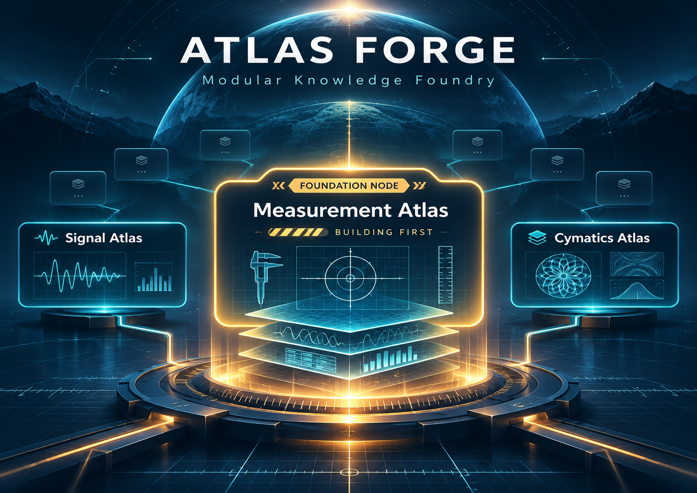

# LANGUAGE ATLAS · Scoped Scientific Reference v1.0.0

**Form → Structure → Meaning → Context → Community → Evidence → Reconstruction**

A self-contained, source-scoped reference to human language, speech, signed languages, writing, syntax, semantics, pragmatics, historical change, typology, translation and documentation. **65 chapters, 40 investigations, 276 exact-version records (39 source cards) and 272 standalone relations.** Five additional cross-domain relations remain in the full nine-node federation. All 224 v0.2 record revisions and 227 v0.2 full relation revisions are preserved.

[Full scientific reference](docs/DEPTH_MANUAL_v1.0.0.md) · [65-chapter guide](docs/REFERENCE_GUIDE.md) · [40 investigations](docs/CASEBOOK.md) · [Source/rights register](docs/SOURCE_REGISTER.md) · [Coverage and open gates](docs/COVERAGE_MATRIX.md) · [Validation](docs/VALIDATION_v1.0.0.md)

## Reproduce the offline methods

```sh
python -m language_atlas v1
python -m language_atlas advanced
python -m unittest discover -s tests -p 'test_v1*.py' -q
python tools/v1_numeric_oracle.py   # optional independent numerical library
```

The new pure-Python models support **finite automaton acceptance, three-valued quantifier scopes, weighted segment alignment, sequential sound-change stages, character n-gram overlap, and rights-aware source-byte review**. These models are finite teaching references, not real grammar, universal translation, authenticated speaker consent or Unicode 18 normative conformance.

**Science and preservation limits:** no genuine speaker/corpus data or community-signed permission attestations; official Unicode 18 normative break test bytes are missing; third-party publisher originals remain external; no live language model performance tested. All numeric examples are constructed and source links preserve only checked scope.

**Order:** build all 30 domain libraries first, then Bitwork routing, integrated evaluation, and desktop transfer. Next in queue: Energy Atlas after Language's scoped content acceptance.
